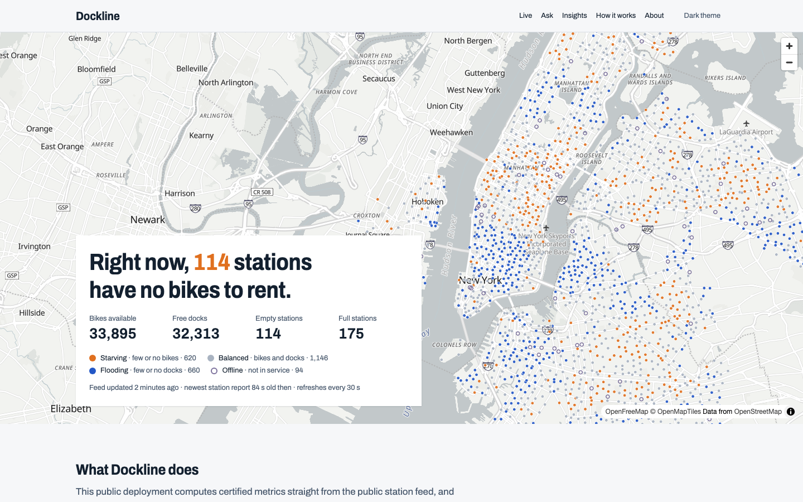
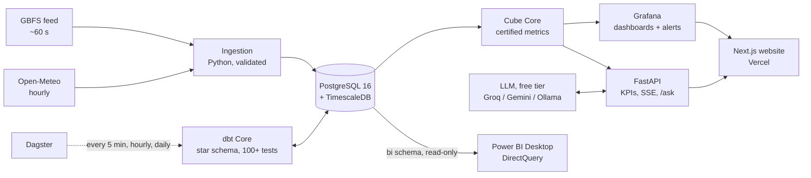

# Dockline

**Live operations intelligence for NYC bike share.**

**[Live demo: dockline-nyc.vercel.app](https://dockline-nyc.vercel.app)**

[](https://dockline-nyc.vercel.app)
[](https://github.com/Gnanasudharsan/dockline-nyc-bikeshare-ops/actions/workflows/snapshot.yml)
[](https://github.com/Gnanasudharsan/dockline-nyc-bikeshare-ops/actions/workflows/uptime.yml)
[](https://github.com/Gnanasudharsan/dockline-nyc-bikeshare-ops/actions/workflows/ci.yml)

Dockline watches every station in New York City's bike share network about once a
minute, keeps every report in a time-series warehouse, turns it into a governed star
schema with certified metrics, and serves those same numbers to four surfaces:

1. **Live operations dashboard** (Grafana)
   - auto-refreshing KPIs and a station map colored by imbalance
   - alerts as code, and rewind to any moment
2. **Analyst report** (Power BI Desktop)
   - DirectQuery, automatic page refresh, row-level security by borough
   - DAX measures with the same names as the certified metrics
3. **Ask the Data**
   - plain-English questions answered *only* through certified metrics
   - the model never writes SQL and cannot invent numbers
4. **Public website**
   - a live map, live KPIs over Server-Sent Events, and a 24-hour replay
   - findings, and how it all works



> Independent project. Not affiliated with Citi Bike or Lyft. Uses the public GBFS feed.

## Architecture



Cube is the only place metrics are defined. Grafana, the API, and the website read
numbers only from Cube; Power BI mirrors its measures by name, and tests enforce it.

## What is in the box

| Layer | What it does | Where |
| --- | --- | --- |
| Ingestion | Polls on the feed's own clock with ETag requests; validates each record; stores each distinct report once; retries; graceful shutdown | [`ingestion/`](ingestion/) |
| Warehouse | TimescaleDB hypertable (compressed after 7 days, 30-day retention), 5-minute and hourly continuous aggregates kept forever, in-house migration runner, read-only serving roles | [`warehouse/`](warehouse/) |
| Models | dbt: a carried-forward station × 5-minute grid, SCD2 stations, hourly and daily facts, an as-of KPI snapshot, live rebalancing and chronic-station marts, borough placement without PostGIS | [`dbt/`](dbt/) |
| Orchestration | Dagster: dbt as assets with lineage; 5-minute, hourly, and daily schedules; freshness policies; failure alerts | [`orchestration/`](orchestration/) |
| Semantic layer | Cube: every metric once, pre-aggregations in Cube Store | [`semantic/`](semantic/), [`docs/metrics.md`](docs/metrics.md) |
| Live ops | Grafana, provisioned entirely as code: 4 dashboards plus a public one; alerts for stale feed, failing ingestion, and empty high-traffic stations | [`grafana/`](grafana/) |
| Analyst BI | Power BI project generated as text (TMDL + PBIR) and validated with Microsoft's schemas and parser | [`powerbi/`](powerbi/) |
| API + Ask the Data | FastAPI; the LLM returns a JSON plan over an allowlisted catalog, strict validation builds the Cube query, and answers are checked against the returned numbers | [`api/`](api/), [`evals/`](evals/) |
| Website | Next.js, TypeScript strict, Tailwind, MapLibre + OpenFreeMap, ECharts; light/dark; WCAG 2.2 AA | [`web/`](web/), [`docs/design/`](docs/design/) |
| Deployment | Snapshot mode (Vercel + a GitHub Actions snapshot every 10 minutes), or the full stack on an Oracle Always Free ARM VM with Caddy + DuckDNS or Cloudflare Tunnel; nightly backups, uptime checks | [`infra/`](infra/), [`docs/deploy/`](docs/deploy/) |

Everything runs on free tiers or open-source software, and every image runs on
`linux/arm64`.

## Quality, measured

| Check | Result |
| --- | --- |
| Python tests: unit plus integration against a throwaway TimescaleDB | 186 |
| dbt tests (dbt-utils, dbt-expectations) | 107 data tests, 2 unit tests, on 26 models |
| Ask the Data evaluation (40 cases, live run) | 31/32 answerable (96.9%), 8/8 refusals (thresholds: ≥ 85%, 100%) |
| Grafana | Every panel query run through Cube in CI |
| Power BI | Microsoft JSON schemas, theme schema, 88 field references, Microsoft `TmdlSerializer` |
| Website, Lighthouse (all pages, mobile and desktop) | 99–100 for performance, accessibility, best practices, and SEO |
| Website, end to end | 6 Playwright tests against a mocked API; 24 design screenshots |
| Backups | Nightly dump restored into a new database with hypertables and aggregates intact |
| Static checks | Ruff, strict mypy, SQLFluff, ESLint, TypeScript strict, Prettier, gitleaks |

The first acceptance runs found real problems:
- a polling timer that phase-locked just before each feed refresh
- a CDN serving stale versions
- an LLM that over-filtered questions
- a map library worker that would not start under the bundler

Each fix is recorded in the [ADRs](docs/adr/) and the [changelog](CHANGELOG.md).

## Run it locally

Prerequisites: Docker (Compose 2.24+), Python 3.12, [uv](https://docs.astral.sh/uv/),
Node 20.9+, GNU Make.

```bash
make setup
```
```bash
make up
```
```bash
make test
```

`make setup` installs the Python tooling and git hooks and creates `.env` with random
local credentials. `make up` starts the stack and waits until every service is healthy.
`make test` runs the full test suite.

| What | Where |
| --- | --- |
| Website (`make web-install && make web-dev`) | <http://localhost:3010> |
| Grafana | <http://localhost:3060> (admin password in `.env`) |
| API docs | <http://localhost:8070/docs>; try `make ask Q="Which borough has the most empty stations right now?"` |
| Dagster | <http://localhost:3070> |
| Cube | <http://localhost:4000>, SQL API on `localhost:15432` |
| Power BI | [`powerbi/Dockline.pbip`](powerbi/) ([checklist](powerbi/VERIFY.md)) |
| Warehouse | `make psql`, or `localhost:5433` |
| Data checks | `make check-ingestion`, `make check-pipeline`, `make check-grafana` |

Ask the Data needs a free LLM key in `.env` (`GROQ_API_KEY` or `GEMINI_API_KEY`), or a
local Ollama. Run `make help` for every target.

## Deployment modes

The public demo runs in **snapshot mode**; the same code also runs as the **full
stack**. One setting, `NEXT_PUBLIC_DEPLOY_MODE`, chooses
([ADR 0022](docs/adr/0022-snapshot-mode.md)).

| | Full stack | Snapshot mode (the live demo) |
| --- | --- | --- |
| Runs on | one free ARM VM (Docker Compose) plus Vercel | Vercel and GitHub Actions only, no server |
| Live numbers | ingestion every minute → TimescaleDB → dbt → Cube | `/api/live` computes them from the public feed, cached about 30 s |
| History | every report, kept in the warehouse | a snapshot every 10 minutes on the `data` branch (24 hours, 30 days of daily KPIs) |
| Grafana, Power BI, Ask the Data | yes | no (the Ask page explains how to run it) |
| Cost | $0 | $0 |

The live metrics in snapshot mode exist twice, in Python (the snapshot workflow) and
TypeScript (`/api/live`). CI runs both on the same recorded feed and requires identical
output, and they were checked against Cube's numbers from the full stack.

## Deploy it

**Snapshot mode:** [docs/deploy/snapshot-mode.md](docs/deploy/snapshot-mode.md).

**Full stack:**

One Oracle Cloud Always Free ARM VM, HTTPS through Caddy with free DuckDNS subdomains
or a Cloudflare Tunnel ([ADR 0021](docs/adr/0021-https-modes.md)), and Vercel for the
website. Step by step: [Oracle VM](docs/deploy/oracle-vm.md) ·
[DuckDNS and Caddy](docs/deploy/duckdns-caddy.md) · [Cloudflare Tunnel](docs/deploy/cloudflare-tunnel.md)
· [Vercel](docs/deploy/vercel.md) · [Operations, backups, and restores](docs/deploy/operations.md).

## Project status

| Phase | Scope | Status |
| --- | --- | --- |
| 0 | Repository and foundation | Done |
| 1 | Live ingestion and storage | Done |
| 2 | dbt models and orchestration | Done |
| 3 | Semantic layer and live Grafana dashboard | Done |
| 4 | Power BI analyst report | Done |
| 5 | Ask the Data (governed natural-language Q&A) | Done |
| 6 | Public website | Done |
| 7 | Deployment and launch | Done (v1.0.0) |
| — | Public deployment (snapshot mode) | Done (v1.1.0), live at [dockline-nyc.vercel.app](https://dockline-nyc.vercel.app) |

## Repository layout

```
ingestion/      GBFS and weather poller
warehouse/      TimescaleDB migrations and acceptance checks
dbt/            staging, intermediate, marts, bi (Power BI contract), snapshots
orchestration/  Dagster code location
semantic/       Cube data model: the single source of metric definitions
grafana/        datasources, dashboards (generated), alert rules
powerbi/        Power BI project (generated), validators, guides
api/            FastAPI service and Ask the Data
evals/          Ask the Data evaluation set and recorded run
web/            Next.js website
infra/          production override, Caddy, DuckDNS updater, backups
docs/           ADRs, metrics catalog, design plan and screenshots, deployment guides
```

Writing: [How Dockline was built](docs/blog-post.md). Decisions:
[`docs/adr/`](docs/adr/).

## License

[MIT](LICENSE) © Gnanasudharsan Ashokumar
