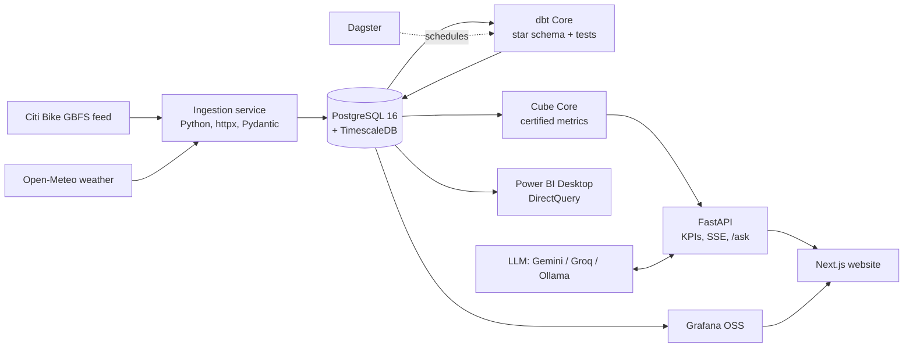

# Dockline

**Live operations intelligence for NYC bike share.**

Dockline reads the public Citi Bike GBFS feed about every 60 seconds, keeps every
station snapshot in a time-series warehouse, models it into a governed star schema
with certified metrics, and serves it to four surfaces:

1. **Live operations dashboard** (Grafana): auto-refreshing KPIs, a station map
   colored by imbalance, alerts, and time travel to any past moment.
2. **Analyst and executive report** (Power BI Desktop): DirectQuery, automatic page
   refresh, DAX measures that mirror the certified metrics, row-level security by borough.
3. **Ask the Data**: natural-language questions answered *only* through certified
   semantic-layer metrics. No raw SQL, no invented numbers.
4. **Public website**: live map hero, live KPIs, written findings, and how it all works.

> Independent project. Not affiliated with Citi Bike or Lyft. Uses the public GBFS feed.

## Project status

| Phase | Scope | Status |
| --- | --- | --- |
| 0 | Repository and foundation | In progress |
| 1 | Live ingestion and storage | Planned |
| 2 | dbt models and orchestration | Planned |
| 3 | Semantic layer and live Grafana dashboard | Planned |
| 4 | Power BI analyst report | Planned |
| 5 | Ask the Data (governed natural-language Q&A) | Planned |
| 6 | Public website | Planned |
| 7 | Deployment and launch | Planned |

## Architecture (target)



## Stack

| Layer | Choice |
| --- | --- |
| Ingestion | Python 3.12, httpx (async), Pydantic v2, tenacity |
| Warehouse | PostgreSQL 16 + TimescaleDB |
| Transformation | dbt Core (dbt-postgres), dbt-expectations |
| Orchestration | Dagster OSS |
| Semantic layer | Cube Core |
| Live dashboard | Grafana OSS (provisioned as code) |
| Analyst BI | Power BI Desktop, PBIP (TMDL + PBIR) |
| API | FastAPI, Server-Sent Events |
| Website | Next.js, TypeScript, Tailwind CSS, MapLibre GL JS, Apache ECharts |
| Infra | Docker Compose, Cloudflare Tunnel, GitHub Actions |

Everything runs on free tiers or open-source software, and every image supports `linux/arm64`.

## Run locally

Prerequisites: Docker (Compose v2), Python 3.12, [uv](https://docs.astral.sh/uv/), GNU Make.

```bash
make setup   # install Python tooling and git hooks, create .env from .env.example
make up      # start the stack and wait until every service is healthy
make test    # run the test suite
```

Other targets: `make lint`, `make logs`, `make down`, `make help`.

## Repository layout

```
ingestion/      GBFS and weather poller service
warehouse/      TimescaleDB migrations
dbt/            staging, intermediate and mart models
orchestration/  Dagster definitions
semantic/       Cube data model (single source of truth for metrics)
grafana/        provisioned datasources, dashboards, alert rules
powerbi/        Power BI Project (TMDL + PBIR) and theme
api/            FastAPI service
web/            Next.js website
infra/          production compose override, deployment guides
docs/           ADRs, metrics catalog, design system
```

## Decisions

Architecture Decision Records live in [`docs/adr/`](docs/adr/).

## License

[MIT](LICENSE) © Gnanasudharsan Ashokumar
